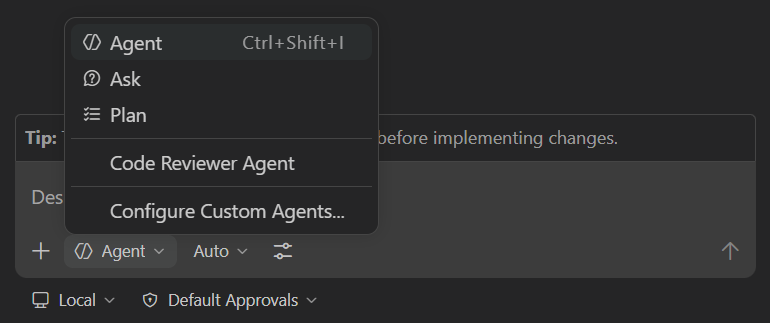

即使是最简单的应用更新，通常也需要修改多个文件并执行测试等操作。作为开发人员，你的工作流程通常包括查找所有相关文件、进行更改、运行测试、调试、找出遗漏的文件、再次更新……类似工作还会不断重复。

Copilot Agent Mode 正是为此而生。

Copilot Agent Mode 可在 IDE 中更自主地工作。它的行为类似开发人员：先探索现有项目结构，再进行必要更新、运行测试等任务，并自动修复发现的问题。接下来了解如何使用 Agent Mode 为网站添加新功能。

> [!NOTE]
> 名称相似，但代理模式和 cloud agent 面向两种不同的体验。代理模式在 IDE 中执行任务，便于快速反馈和交互；cloud agent 则像团队成员一样异步工作，通过 issue 和拉取请求与你协作。

在本练习中，你将了解：

- Copilot Agent Mode 如何探索项目、查找相关文件并协调修改。
- GitHub Copilot Agent Mode 如何跨用户界面 (UI) 和数据层实现新功能。
- 合并代码前，如何审查 Copilot Agent Mode 生成的更改和测试。

## 场景

随着游戏列表不断增长，你希望允许用户按类别和发行商筛选。上一练习中已经添加了发行商辅助函数，现在将使用 Copilot Agent Mode 完成数据层、UI 和测试的其余工作。

## 运行 Tailspin Toys 网站

在进行更改之前，先探索 Tailspin Toys 网站，了解其当前功能。

该网站是面向开发者主题棋盘游戏的众筹平台，允许用户浏览游戏列表和详情。它是单个 Astro 应用，在构建时将页面渲染为静态 HTML。页面通过 Drizzle ORM 在 frontmatter 中直接查询本地 SQLite 数据库；没有单独的后端 API，也没有客户端 UI 框架。可复用的数据访问辅助函数位于 `src/lib/` 中，交互功能则通过使用标准 DOM API 的小型、作用域限定的 Astro `<script>` 实现。

### 启动网站

项目提供了 `npm run dev` 任务，可启动单个 Astro 开发服务器。在 GitHub Codespace 中按以下步骤运行：

1. 返回 codespace。上一练习结束后应已切回 `main`。
2. 按 <kbd>Control</kbd>+<kbd>`</kbd>（Mac）或 <kbd>Ctrl</kbd>+<kbd>`</kbd>（Windows/Linux），在 Codespace 中打开新终端。
3. 创建并切换到用于筛选工作的新分支：

   ```bash
   git checkout main
   git pull
   git checkout -b filtering-vscode
   ```

4. 运行以下命令启动网站：

   ```bash
   npm run dev
   ```

   Astro 开发服务器就绪后，应会显示类似以下内容的 URL 横幅：

   ```bash
   🚀 Tailspin Toys is ready!
      Astro server: http://localhost:4321
      Press Ctrl-C to stop.
   ```

> [!NOTE]
> 如果弹出对话框，提示你打开 `http://localhost:4321`，请通过选择 **x** 关闭对话框。

5. 按住 <kbd>Command</kbd>（Mac）或 <kbd>Ctrl</kbd>（Windows/Linux），并在终端中选择 Astro 服务器地址 `http://localhost:4321`，打开网站。

> [!NOTE]
> 使用 codespace 时，从 Codespace 终端选择 localhost URL 链接会自动重定向到 `https://<your-codespace-name>-4321.app.github.dev/`。这是指向当前托管 Web 服务器的 codespace 的专用隧道！

### 浏览网站

网站运行后即可探索其功能。主要功能包括：

- **主页**：显示棋盘游戏列表，包括标题、图片和说明。
- **游戏详情页**：选择游戏后会打开详情页，其中包含标题、说明、发行商和类别等信息。

## 使用 Copilot 探索待办列表

> [!TIP]
> **打开 Copilot Chat**
>
> 开始以下练习前，返回 codespace，打开 Copilot Chat 面板并选择 **New Chat**，开始新的对话。不同练习的模式和模型选择可能不同；相关步骤会在需要时说明。

网站的初始实现可以正常运行，但我们希望添加新功能。先查看待办列表。使用模板创建项目时，系统已自动创建一组 issue；请让 GitHub Copilot 列出这些 issue。

1. 在 Chat 视图的代理下拉列表中选择 **Agent**。**Agent** 代理可以自主规划并跨文件实现更改、运行终端命令和调用工具。

   

2. 从可用模型列表中选择 **Claude Sonnet 4.5**。

> [!CAUTION]
> 本工作坊作者并未偏好某个模型。编写本工作坊时使用了 Claude Sonnet 4.5，因此在说明中列出该模型，希望代码建议相对一致，便于获得良好体验。不过，LLM 具有概率性，因此你收到的建议可能与工作坊示例不同。这是正常且符合预期的。

> [!NOTE]
> 由于 LLM 具有概率性，Copilot 可能会使用不同的 MCP 命令，但仍应能够完成任务。

3. 向 Copilot 发送以下提示，询问待办 issue：

   ```plaintext
   Please show me the backlog of items from my GitHub repository. Help me prioritize them based on those which will be most useful to the user.
   ```

4. 选择 **Continue** 以运行列出所有 issue 的命令。
5. 查看生成的 issue 列表。

留意 Copilot 还根据它判断的用户价值为这些事项排定了优先级。

## 查看指令文件

让代理生成代码之前，先查看用于向 Copilot 提供上下文的指令文件。本练习将使用[用户界面 (UI)](https://github.com/github-samples/tailspin-toys/blob/main/.github/instructions/ui.instructions.md) 指令文件，其中包含有关如何为网站添加功能的上下文。

1. 在 codespace 中打开 `.github/instructions/ui.instructions.md`。
2. 留意文件中有关添加功能的整体指南，包括：
   - 架构概述。
   - 组件设计、可测试性和无障碍访问原则。
   - 指向特定文件类型指令文件的链接，包括：
     - Astro
     - Tailwind CSS
     - Drizzle

> [!TIP]
> 指令文件可以引用其他指令文件和项目文件。路径相对于指令文件所在位置。这样可以复用内容、将复杂指令拆分为更易管理的部分，并提供示例和模板。

## 实现筛选功能

完成筛选至少需要对应用进行三项更新：

- 在数据层 (`src/lib/`) 中添加或完善其余筛选逻辑。
- 为筛选行为添加或更新测试。
- 更新游戏列表页，添加筛选 UI。

此外，合并前必须运行测试并确保通过。Copilot Agent Mode 可以代你完成这些任务，现在开始添加功能。

1. 可以继续当前 Copilot 对话，也可以选择 **New Chat** 开始新对话。
2. 依次选择 **Add Context**、**Instructions** 和 **ui**，添加指令文件。

   

3. 确认 Chat 视图的代理下拉列表中仍选中 **Agent**。

   

4. 确认仍为模型选择 **Claude Sonnet 4.5**。
5. 使用以下提示，根据待办列表中的相关 issue 要求 Copilot 实现功能：

   ```plaintext
   Please update the site to include filtering by publisher and category based on the requirements from the related GitHub issue in the backlog. A publishers helper already exists from the previous exercise, so preserve and refine that work as needed while completing the remaining data-layer, UI, and tests. Ensure all tests are passing before completion. The server is already running, so you do not need to start it up.
   ```

6. 观察 Copilot 如何先探索项目并查找相关文件。它应找到数据层辅助函数、UI 和测试，然后开始修改文件并运行测试。

   

> [!NOTE]
> Copilot 会执行多项任务，例如探索项目、修改文件和运行测试。根据任务和代码库的复杂程度，此过程可能需要几分钟。过程中，编辑器中可能会出现 **Keep** 和 **Undo** 按钮。Copilot 完成后，所有更改都会显示 **Keep** 或 **Undo** 按钮，因此无需在工作进行时选择它们。

7. Copilot 提示时，选择 **Continue** 运行测试。

   

8. 过程中可能会暂停，甚至有测试失败。这没有关系！Copilot 会在生成代码和运行测试之间反复迭代，直到完成任务且未检测到错误。

   

9. 查看生成的代码，检查潜在问题。

> [!CAUTION]
> 请记住，务必审查 Copilot 或任何 AI 工具生成的代码。

10. 返回正在运行网站的浏览器，体验新功能。
11. 确认功能正常并审查代码后，在 Copilot Chat 窗口中选择 **Keep**。

## 总结和后续步骤

本练习介绍了如何使用 GitHub Copilot Agent Mode 为 Tailspin Toys 网站添加功能。你了解了如何：

- 使用 GitHub Copilot Agent Mode 跨 UI 和数据层实现新功能。
- 使用 Copilot Agent Mode 探索项目、查找相关文件并协调修改。
- 合并代码前审查 Copilot Agent Mode 生成的更改和测试。

接下来，使用 [Playwright MCP 服务器测试功能][next-lesson]，并为其创建拉取请求。

### 附加探索练习 — 实现分页

随着游戏列表不断增长，需要支持分页。运用本练习中学到的技能，提示 Copilot 更新网站以实现分页。编写提示时可考虑以下因素：

- 遵循现有最佳实践，包括使用现有指令文件。
- 考虑分页的实现方式：允许用户选择每页大小，还是使用固定值。
- 编写提示时，提供 Copilot 实现所需的指导。
- 可能需要与 GitHub Copilot 反复迭代、请求更改并提供上下文。这是与 Copilot 协作的正常流程。

## 资源

- [Copilot 的 ask、edit 和 agent 模式：功能和适用场景][choose-mode]
- [VS Code 中的代理模式][vs-code-agent-mode]

[previous-lesson]: ../1-custom-instructions/
[next-lesson]: ../3-mcp/
[choose-mode]: https://github.blog/ai-and-ml/github-copilot/copilot-ask-edit-and-agent-modes-what-they-do-and-when-to-use-them/
[vs-code-agent-mode]: https://code.visualstudio.com/docs/copilot/chat/chat-agent-mode
